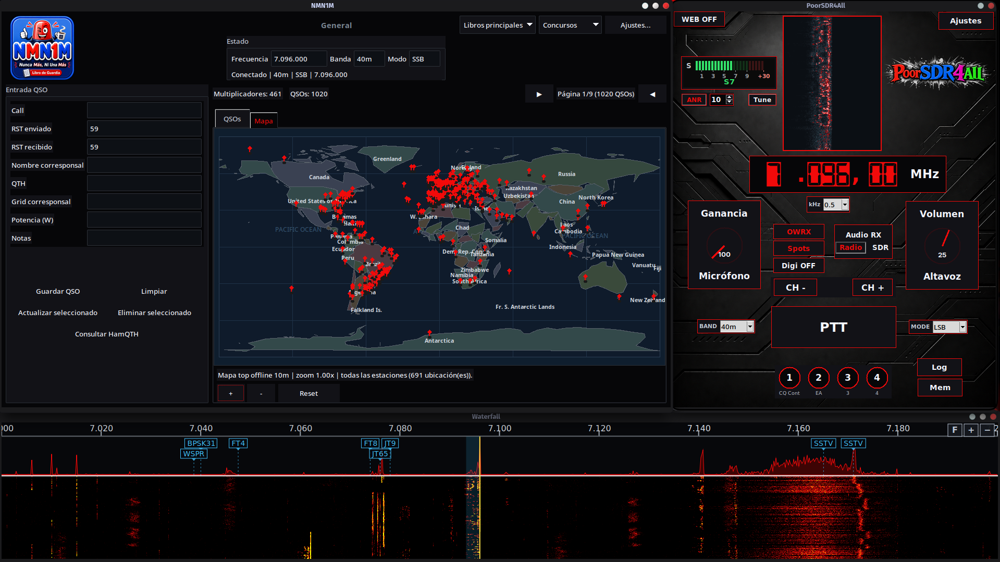

<p align="center">
  
</p>

# PoorSDR4All

**English** · [Español](#español)

Radio operating console: CAT control, rigctld proxy, OpenWebRX+, waterfall,
digital modes, remote web server, calling (CQ) macros and plugins.

📖 **Wiki / user documentation:** https://acuanticopower.com/poorsdr4all/ *(in Spanish)*

<p align="center">
  
</p>

This is the first public **Alpha** release. It works in the main development
environment, but it still needs community validation with more radios, audio
devices and operating systems.

> **Language note:** the documentation inside this repository (`docs/`, the
> installer READMEs, the plugins) is currently written in Spanish. The
> application interface is available in several languages.

## Linux installation — graphical installer (recommended)

The easiest way to install PoorSDR4All is the official graphical installer: a
single self-extracting file that installs the dependencies, OpenWebRX+, the LED
font for the frequency display and a launcher in the applications menu, without
touching the terminal.

**[⬇ Download the Linux installer (Releases)](https://github.com/Acuantico/poorsdr4all/releases/latest)**

It works on Arch Linux, Debian, Ubuntu and Raspberry Pi OS (64-bit). Verify the
integrity of the downloaded file with the `.sha256` that ships with every
release:

```sh
chmod +x poorsdr4all-installer-*-linux.run
sha256sum -c poorsdr4all-installer-*-linux.run.sha256
./poorsdr4all-installer-*-linux.run
```

Under the hood it literally runs `scripts/install.sh` (see below) with a
graphical front end on top — it doesn't reimplement anything. Details of the
wizard, environment variables and verification are in
[`installer-build/README.md`](installer-build/README.md) and
[`docs/INSTALL.md`](docs/INSTALL.md).

## Windows installation — graphical installer

**[⬇ Download the Windows installer (Releases)](https://github.com/Acuantico/poorsdr4all/releases/latest)**

A single `.exe` (Windows 10 version 2004 or later / Windows 11, 64-bit). It
installs the application, sets up **WSL2** and leaves **OpenWebRX+** running
inside its own private Linux (Ubuntu 24.04), which is created automatically.
OpenWebRX+ and the spots start when PoorSDR4All opens and stop when it closes,
as on Linux. WSL2 needs hardware virtualization (Intel VT-x or AMD-V, enabled in the BIOS/UEFI): the installer checks it first and, if it is not available, installs PoorSDR4All without OpenWebRX+ and explains why. An Internet connection is required: the first time it downloads
Ubuntu (~370 MB) and builds OpenWebRX+ (20–40 minutes). Optionally it installs
RTTY Power, the station log book «Libro de guardia» (NMN1M) and USB SDR support.
It also downloads PyAV (which includes FFmpeg) from PyPI, with its SHA-256 hash
verified, for the web access audio and the macros' mp3 files: it is not bundled
inside the installer because of FFmpeg's license. Details in
[`installer-windows/README.md`](installer-windows/README.md).

## Status by platform

| Platform | Alpha status | Scope |
|---|---|---|
| Arch Linux x86-64 | Functional validation by the maintainer | Main platform |
| Debian/Ubuntu x86-64 and arm64 | Automated build and tests planned | Pending validation on real hardware |
| Windows 10/11 x86-64 | Graphical `.exe` installer (WSL2 + OpenWebRX+); tested in a Windows 11 virtual machine | Alpha; not yet tested with a real SDR or on users' machines |

CI results check that the code installs, passes its tests and builds; they are
not a substitute for a physical test of radio, CAT, SDR or audio. Failure
reports from other platforms are welcome in the issue tracker.

## Manual installation from source

An alternative to the graphical installer above: for Windows, for those who
prefer to review every step, or to integrate PoorSDR4All into their own
environment. Python 3.11 or later is required. The C accelerator is optional:
if it is not built, the waterfall uses the bundled Python implementation.

```sh
git clone https://github.com/Acuantico/poorsdr4all.git
cd poorsdr4all
python -m venv .venv
. .venv/bin/activate
python -m pip install --upgrade pip
python -m pip install .
python scripts/build_native.py       # optional
python -m poorsdr
```

In Windows PowerShell:

```powershell
git clone https://github.com/Acuantico/poorsdr4all.git
Set-Location poorsdr4all
py -3.11 -m venv .venv
.venv\Scripts\Activate.ps1
python -m pip install --upgrade pip
python -m pip install .
python scripts\build_native.py       # optional; requires MSVC, clang or gcc
python -m poorsdr
```

The full OpenWebRX+ installer for Arch and Debian is documented in
[`docs/INSTALL.md`](docs/INSTALL.md). No native binaries are included in the
repository: each machine builds them for its own system.

## Included plugins

Plugins are separate, optional distributions: PoorSDR4All works without any of
them. Install only the ones you want, in the same environment:

```sh
python -m pip install ./plugins/rtty-power
```

The graphical installer and `scripts/install.sh` can also install them
(`INSTALL_PLUGIN_RTTY=1`, `INSTALL_PLUGIN_NMN1M=1`); by default they install
none.

- **[RTTY Power](plugins/rtty-power/README.md)** — «RTTY» button: RTTY decoder
  and TX using the uSDX audio, with helpers for contests (CQ WW RTTY).
  Wiki / user manual: https://acuanticopower.com/poorsdr4all/rtty-power/
  *(in Spanish)*

The «Log» button is provided by **[Nunca Más, Ni Una Más (NMN1M)](https://github.com/Acuantico/nmn1m)**,
a station log book / contest logger that is its own independent project, with
its own wiki: https://acuanticopower.com/nmn1m/ *(in Spanish)* — install it
separately in the same environment so the console discovers it; without it the
console works just the same, only without that button.

Configuration, logs and databases are stored in the user's directories, never
inside the installed package.

## Architecture

```text
poorsdr/
  infra/        user paths, logging and EventBus
  config/       typed model and configuration migration
  core/         pure logic for CAT, bands, tuning, waterfall and OWRX
  services/     radio, audio, rigctld, OWRX and web lifecycle
  ui/           Tkinter interface
  viewers/      waterfall and digital panel
  i18n/         translations
  _vendor/      legacy adapters and an identified AGPL component
```

The dependency direction is `ui → services → core/config/infra`. See
[`docs/ARCHITECTURE.md`](docs/ARCHITECTURE.md) for details.

## Security

The web server is disabled by default and does not start without a password and
a signing secret. Do not expose the CAT, rigctld, OpenWebRX or spiderd ports
directly to the Internet. See [`SECURITY.md`](SECURITY.md).

To control the radio away from home, PoorSDR4All includes a built-in WireGuard VPN
(Settings → VPN) that needs no administrator rights and leaves the web panel
reachable only through the tunnel; remote PTT has a dead-man switch and a
continuous-TX limit. See [`docs/REMOTO.md`](docs/REMOTO.md) (in Spanish).
WireGuard is a registered trademark of Jason A. Donenfeld; PoorSDR4All is not affiliated with or endorsed by the WireGuard project.

## Licenses

The original PoorSDR4All code is offered under the
**[PolyForm Noncommercial License 1.0.0](https://acuanticopower.com/poorsdr4all/license)**.
Commercial use requires a separate agreement with **Acuantico Power**:

https://acuanticopower.com/en/contact/

PoorSDR4All is source-available software, not open-source software approved by
the OSI. Some components and data keep their AGPL, GPL, BSD, MIT, CC-BY or
public-domain terms. Their revisions, changes, attributions and texts can be
found in [`THIRD_PARTY_NOTICES.md`](THIRD_PARTY_NOTICES.md) and `LICENSES/`.

External contributions require accepting the [`CLA.md`](CLA.md). The rules are
in [`CONTRIBUTING.md`](CONTRIBUTING.md).

## Development and release

```sh
python -m pip install -e ".[dev,web]"
ruff check src tests
mypy src
pytest -q
python scripts/check_release.py
python -m build
python scripts/write_checksums.py
python scripts/check_artifacts.py
```

The full procedure is in [`docs/RELEASING.md`](docs/RELEASING.md).

---

# Español

[English](#poorsdr4all) · **Español**

Consola de operación de radio: control CAT, proxy rigctld, OpenWebRX+, cascada,
modos digitales, servidor web remoto, macros de llamada y plugins.

📖 **Wiki / documentación de usuario:** https://acuanticopower.com/poorsdr4all/

Esta es la primera versión pública **Alpha**. Es funcional en el entorno
principal de desarrollo, pero todavía necesita validación comunitaria con más
radios, dispositivos de audio y sistemas operativos.

## Instalación en Linux — instalador gráfico (recomendado)

La forma más sencilla de instalar PoorSDR4All es el instalador gráfico
oficial: un único fichero autoextraíble que instala dependencias, OpenWebRX+,
la fuente LED del frecuencímetro y un acceso directo en el menú de
aplicaciones, sin tocar la terminal.

**[⬇ Descargar el instalador para Linux (Releases)](https://github.com/Acuantico/poorsdr4all/releases/latest)**

Compatible con Arch Linux, Debian, Ubuntu y Raspberry Pi OS (64 bits).
Verifica la integridad del fichero descargado con el `.sha256` que acompaña a
cada versión:

```sh
chmod +x poorsdr4all-installer-*-linux.run
sha256sum -c poorsdr4all-installer-*-linux.run.sha256
./poorsdr4all-installer-*-linux.run
```

Bajo el capó ejecuta literalmente `scripts/install.sh` (ver más abajo) con una
interfaz gráfica encima — no reimplementa nada. Detalles del asistente,
variables de entorno y verificación en
[`installer-build/README.md`](installer-build/README.md) y
[`docs/INSTALL.md`](docs/INSTALL.md).

## Instalación en Windows — instalador gráfico

**[⬇ Descargar el instalador para Windows (Releases)](https://github.com/Acuantico/poorsdr4all/releases/latest)**

Un solo `.exe` (Windows 10 2004 o posterior / Windows 11, 64 bits). Instala la
aplicación, prepara **WSL2** y deja **OpenWebRX+** funcionando dentro de un
Linux propio y privado (Ubuntu 24.04) que se crea solo. OpenWebRX+ y los spots
arrancan al abrir PoorSDR4All y se detienen al cerrarlo, como en Linux. WSL2 necesita virtualización por hardware (Intel VT-x o AMD-V, activada en la BIOS/UEFI): el instalador lo comprueba antes y, si no está disponible, instala PoorSDR4All sin OpenWebRX+ y explica el motivo.
Necesita conexión a Internet: la primera vez descarga Ubuntu (~370 MB) y
compila OpenWebRX+ (20-40 minutos). Opcionalmente instala RTTY Power, el Libro
de guardia (NMN1M) y el soporte para SDR por USB. Descarga además, de PyPI y
con su huella SHA-256 comprobada, PyAV (que incluye FFmpeg) para el audio del
acceso web y los mp3 de las macros: no va dentro del instalador por la licencia
de FFmpeg. Detalles en [`installer-windows/README.md`](installer-windows/README.md).

## Estado por plataforma

| Plataforma | Estado de la Alpha | Alcance |
|---|---|---|
| Arch Linux x86-64 | Validación funcional del mantenedor | Plataforma principal |
| Debian/Ubuntu x86-64 y arm64 | Compilación y pruebas automatizadas previstas | Pendiente de validación con hardware real |
| Windows 10/11 x86-64 | Instalador gráfico `.exe` (WSL2 + OpenWebRX+); probado en una máquina virtual con Windows 11 | Alpha; sin probar aún con un SDR real ni en equipos de usuarios |

Los resultados de CI comprueban que el código se instala, se prueba y se
compila; no equivalen a una prueba física de radio, CAT, SDR o audio. Los fallos
de otras plataformas son bienvenidos en el gestor de incidencias.

## Instalación manual desde el código fuente

Alternativa al instalador gráfico de arriba: para Windows, para quien prefiera
revisar cada paso, o para integrar PoorSDR4All en un entorno propio. Se
requiere Python 3.11 o posterior. El acelerador C es opcional: si no se
compila, la cascada utiliza la implementación Python incluida.

```sh
git clone https://github.com/Acuantico/poorsdr4all.git
cd poorsdr4all
python -m venv .venv
. .venv/bin/activate
python -m pip install --upgrade pip
python -m pip install .
python scripts/build_native.py       # opcional
python -m poorsdr
```

En PowerShell de Windows:

```powershell
git clone https://github.com/Acuantico/poorsdr4all.git
Set-Location poorsdr4all
py -3.11 -m venv .venv
.venv\Scripts\Activate.ps1
python -m pip install --upgrade pip
python -m pip install .
python scripts\build_native.py       # opcional; requiere MSVC, clang o gcc
python -m poorsdr
```

El instalador completo de OpenWebRX+ para Arch y Debian está documentado en
[`docs/INSTALL.md`](docs/INSTALL.md). No se incluyen binarios nativos en el
repositorio: cada equipo los compila para su sistema.

## Plugins incluidos

Los plugins son distribuciones separadas y opcionales: PoorSDR4All funciona
sin ninguno. Instala solo los que quieras, en el mismo entorno:

```sh
python -m pip install ./plugins/rtty-power
```

El instalador gráfico y `scripts/install.sh` también pueden instalarlos
(`INSTALL_PLUGIN_RTTY=1`, `INSTALL_PLUGIN_NMN1M=1`); por defecto no instalan
ninguno.

- **[RTTY Power](plugins/rtty-power/README.md)** — botón «RTTY»: decodificador
  y TX RTTY con el audio del uSDX, con ayudas para concursos (CQ WW RTTY).
  Wiki / manual de uso: https://acuanticopower.com/poorsdr4all/rtty-power/

El botón «Log» lo aporta **[Nunca Más, Ni Una Más (NMN1M)](https://github.com/Acuantico/nmn1m)**,
un cuaderno de estación / contest logger que es su propio proyecto
independiente, con su propia wiki: https://acuanticopower.com/nmn1m/ —
instálalo aparte en el mismo entorno para que la consola lo descubra; sin él,
la consola funciona igual, solo sin ese botón.

La configuración, logs y bases de datos se guardan en los directorios del
usuario, nunca dentro del paquete instalado.

## Arquitectura

```text
poorsdr/
  infra/        rutas de usuario, logging y EventBus
  config/       modelo tipado y migración de configuración
  core/         lógica pura de CAT, bandas, sintonía, cascada y OWRX
  services/     ciclo de vida de radio, audio, rigctld, OWRX y web
  ui/           interfaz Tkinter
  viewers/      cascada y panel digital
  i18n/         traducciones
  _vendor/      adaptadores heredados y componente AGPL identificado
```

La dirección de dependencias es `ui → services → core/config/infra`. Consulta
[`docs/ARCHITECTURE.md`](docs/ARCHITECTURE.md) para el detalle.

## Seguridad

El servidor web está desactivado por defecto y no arranca sin contraseña y
secreto de firma. No publiques directamente en Internet los puertos CAT,
rigctld, OpenWebRX o spiderd. Consulta [`SECURITY.md`](SECURITY.md).

Para manejar la radio desde fuera de casa, PoorSDR4All incluye una VPN WireGuard
integrada (Ajustes → VPN) que no necesita permisos de administrador y deja el
panel web accesible solo por el túnel; el PTT remoto tiene "hombre muerto" y
límite de TX continua. Ver [`docs/REMOTO.md`](docs/REMOTO.md).
WireGuard es una marca registrada de Jason A. Donenfeld; PoorSDR4All no está afiliado ni respaldado por el proyecto WireGuard.

## Licencias

El código original de PoorSDR4All se ofrece bajo la
**[PolyForm Noncommercial License 1.0.0](https://acuanticopower.com/poorsdr4all/license)**.
Para uso comercial se requiere un acuerdo separado con **Acuantico Power**:

https://acuanticopower.com/contacto/

PoorSDR4All es código fuente disponible (*source-available*), no software de
código abierto aprobado por la OSI. Algunos componentes y datos conservan
AGPL, GPL, BSD, MIT, CC-BY o dominio público. Sus revisiones, cambios,
atribuciones y textos se encuentran en
[`THIRD_PARTY_NOTICES.md`](THIRD_PARTY_NOTICES.md) y `LICENSES/`.

Las contribuciones externas requieren aceptar [`CLA.md`](CLA.md). Las normas
están en [`CONTRIBUTING.md`](CONTRIBUTING.md).

## Desarrollo y release

```sh
python -m pip install -e ".[dev,web]"
ruff check src tests
mypy src
pytest -q
python scripts/check_release.py
python -m build
python scripts/write_checksums.py
python scripts/check_artifacts.py
```

El procedimiento completo está en [`docs/RELEASING.md`](docs/RELEASING.md).
